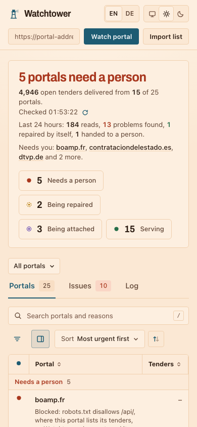

# Watchtower

Watchtower connects public-tender portals on its own, watches whether each one still delivers correctly, and repairs itself when a portal changes. Built for Patterno's challenge at the MAIN AI Hackathon 2026.

## Try it in 2 minutes

From the repository root, create `.env` if you don't already have one, then set `OPENAI_API_KEY`, `MODEL_SMART`, and `MODEL_FAST` in it. See [Environment variables](#environment-variables) for provider settings.

```bash
test -f .env || cp .env.example .env
docker build -t watchtower .
docker run -p 8080:8080 --env-file .env watchtower
```

Open http://localhost:8080. In a second terminal, register a portal:

```bash
curl -fsS http://localhost:8080/portals \
  -H 'Content-Type: application/json' \
  --data '{"url":"https://www.tenderned.nl/aankondigingen/overzicht"}'
```

The API returns an ID immediately; the first read runs in the background and can take longer than two minutes. **Portals** shows delivery state, tender counts, and a map; open a row for its run history. **Issues** shows what needs attention, what is being repaired, and what recovered. **Log** shows what happened across portals. The theme switch offers light, dark, or system settings.

**Demo without a model key:** with Node.js 22.13 or later, run the following and open http://localhost:8083. The demo seeds sample portals and repair history, disables new registrations, and never starts scheduled reads or model calls. Only an explicit **Read now** starts a read and may change the sample data. The hosted `SEED_DEMO=1` mode follows the same rules.

```bash
npm ci
npm run build:web
DATA_DIR=/tmp/wt-demo PORT=8083 npx tsx scripts/demo.ts
```

| Portals · light | Issues · dark | Portals · phone |
|---|---|---|
| [](docs/screens/portals-light.png) | [](docs/screens/issues-dark.png) | [](docs/screens/phone-light.png) |

Local development: `npm install`, `npx playwright install chromium` (once), then `npm run dev` (API) and `npm run dev:web` (dashboard).

**Team: start with [docs/ONBOARDING.md](docs/ONBOARDING.md).**

## How it works

**The model proposes, code decides.** A model is used to learn a portal and to repair it. Reading a portal is plain code, so the regular work costs nothing in model usage and gives the same answer every time.

1. **Attach.** For a portal it has never seen, the Cartographer explores the site once and writes a **recipe**: a small JSON file that says where the tender list is (a feed, a JSON API, HTML or a page that needs a browser), how to page through it, where each field and each document is, and which time zone the portal uses. Code then reads the portal with that recipe and keeps a few **golden tenders**, real tenders it can check later.
2. **Read.** On a schedule (every 30 minutes by default) the Extractor runs the recipe. **No model call.** New and changed tenders get their documents downloaded, hashed (sha256) and unpacked if they are ZIPs. A big portal is served in batches: each read downloads at most 300 documents, newest tenders first, and the next read follows a minute later until all are in. A new tender is served only with its documents, never with an empty list that would look like "no documents".
3. **Notice.** Before anything is served, deterministic checks decide whether the read is correct: ids unique, dates and deadlines valid, URLs and CPV codes well formed, the number of tenders not collapsing, the page structure unchanged, and the golden tenders still matching. A portal that says "no tenders" is told apart from one that broke.
4. **Repair.** When the checks fail, the portal goes to `healing` and the last correct tenders stay available. The Medic shows the model what changed and gets back a small patch to the recipe. Code reruns the read with the patch and serves it only if every check passes, golden tenders included. If no patch passes, the portal goes to `failed` and says why.

Each portal is always in one of four states, with a one-sentence `reason` an operator can act on:

| State | Meaning | Example reason |
|---|---|---|
| `integrating` | Being attached, nothing delivered yet. | Attaching: learning how to read this portal. |
| `serving` | Delivering correctly. | Serving 23 open tenders (2 new, 1 changed). Last read 10:42, all checks passed. |
| `healing` | A read looked wrong; repairing while the last correct tenders stay served. | Repairing: no tender has a title (0 of 23). |
| `failed` | Cannot deliver; a person is needed. Logins and captchas end here. | Documents need a login: the portal shows a login page instead of the file. |

**Polite by construction.** Every request, from plain HTTP or from the headless browser, passes one gate per portal: at most one request every 1.1 seconds, robots.txt respected (Allow, Disallow, wildcards). No logins and no captcha solving. A portal that shows a captcha but still hands out its files is read normally; one that blocks is `failed`, and the reason says so. `DELETE` stops all traffic to a portal at once, open browser pages and downloads included.

**Documents.** Files stream to disk and are never held in memory. ZIPs are unpacked, one nested ZIP deep. Files over 250 MB are left out, checked from the declared size first and counted while streaming. Multi-step downloads (click through to the file) run in the browser. Each file is served from `/files/{sha256}`.

In company deployments, put the dashboard behind company single sign-on via a reverse proxy; the evaluation container stays open.

## Environment variables

| Name | Required | Default | Meaning |
|---|---|---|---|
| `OPENAI_API_KEY` | yes | | Model key (OpenAI or any OpenAI-compatible provider). |
| `MODEL_SMART` | yes | | Model for attaching and repairing. We use `gpt-6.2-sol`. |
| `MODEL_FAST` | yes | | Model for triage. We use `gpt-6-luna`. |
| `OPENAI_BASE_URL` | no | OpenAI | Endpoint of an OpenAI-compatible provider. |
| `PRICE_SMART_IN`, `PRICE_SMART_OUT`, `PRICE_FAST_IN`, `PRICE_FAST_OUT` | no | 0 | USD per million tokens, so the cost ledger shows money and not only tokens. |
| `PRICE_SMART_CACHED_IN`, `PRICE_FAST_CACHED_IN` | no | Half the corresponding input price | USD per million cached input tokens. |
| `LLM_PROMPT_CACHE` | no | Enabled | Set to `0` to disable prompt caching. |
| `MAX_MODEL_USD_PER_PORTAL` | no | 1.00 | Recorded model spend limit per portal across its lifetime; `0` disables its model calls. |
| `MAX_MODEL_USD_PER_DAY` | no | 20 | Recorded model spend limit across all portals per server-local day; `0` disables model calls. |
| `PORT` | no | 8080 | HTTP port. |
| `DATA_DIR` | no | `/data` in the container | SQLite database and downloaded files. |
| `READ_INTERVAL_MINUTES` | no | 30 | Time between regular reads of a serving portal. |
| `FAILED_RETRY_MINUTES` | no | 30 | Time between retries of a failed portal. |
| `DOC_REFS_PER_READ` | no | 300 | Document downloads per read at most; on a big portal the rest follow in reads one minute apart. |
| `MIN_REQUEST_GAP_MS` | no | 1100 | Gap between two requests to one portal; never below 1000. |
| `MAX_FILE_BYTES` | no | 262144000 (250 MB) | Largest document kept. |
| `BROWSER_STEP_MS` | no | 20000 | How long a browser download waits for a page, a click target or the file. |
| `USER_AGENT` | no | `WatchtowerBot/0.1 (...)` | How we identify ourselves to portals. |
| `TZ_DISPLAY` | no | `Europe/Berlin` | Time zone for times the system itself writes. |
| `LOG_LEVEL` | no | `warn` | Server log level. |

## Access

There is no authentication, as the brief specifies: the API and the dashboard answer without a login. In a production deployment, put the dashboard behind your own single sign-on (for example a reverse proxy) and keep the API on a private network.

## Approach: scale and model cost

Reads run in parallel across portals and are rate-limited to at most one request per second per portal. Portals on the same software can reuse one learned family recipe if it passes a deterministic trial, without another model call for attach.

The first read on a large portal does a bounded amount of detail and document work, but downloads are still limited to one request per second per portal: in our TenderNed run, 2,592 tenders were listed and the first 36 were served after about 14 minutes. Small portals in our lab served their first tenders in 1–3 minutes; once the initial backlog clears, later reads check the listing and fetch only new or changed details and attachments.

Attach and repair reserve estimated worst-case request headroom before sending each model call. Set the input and output prices to match the provider for these local limits to reflect actual spend. Provider billing is authoritative; usage a provider does not report is not visible to the ledger.

Every model call is recorded with its purpose, tokens and cost: `GET /internal/ledger` for all portals, `GET /internal/portals/{id}` for one. The ledger includes `cached_tokens` only when a nonzero count has been recorded by the model client.

| Operation | Model cost |
|---|---|
| Attach (once) | **$0.033** average per portal |
| Regular read | **$0** (no model calls) |
| Repair | **$0.021** average per scenario that started a repair |

**Attach:** B’s [November 20, 2026, 23:12 CET attach-only eval](status/B.md) on three lab portals measured **100% attach accuracy**, **0 wrong values**, and **$0.033 per attach** on average.

**Attach recheck:** November 21, 2026, approximately 00:59–01:04 CET, `lab/eval.ts --attach-only` on `29ec17a`: Gmina twice (13/13 each), Stadtwerke (14/14), and Ville (11/11) all scored **100%**. This was an attach-only recheck, not a new repair benchmark.

**Repair:** D’s [November 20, 2026, 22:28 CET full lab eval](status/D.md) measured **$0.021** per scenario that started a repair, **85%** of breaking changes healed (**11 of 13**), and **16 s** median heal time. Watchtower started a repair on **3 of 6** harmless changes. These are separate lab runs, not real-portal averages.

**At 1,000 portals:** using the lab average and assuming every portal needs its own model-assisted attach, budget about **1,000 × $0.033 = $33 once**, plus repair costs when portals change. Regular reads make no model calls and cost **$0 in model usage**. Family reuse can lower the initial cost.

**What it saves:** at 300 portals, keeping scrapers working by hand costs an estimated €36,000–132,000 a year in engineering time; with Watchtower about €8,000–22,000, mostly the person who handles the breaks it cannot repair. Mid case: about **€47,500 saved a year (81%)**. Assumptions and sources: [docs/SAVINGS.md](docs/SAVINGS.md).

## API

| Call | Answer |
|---|---|
| `POST /portals` `{ "url": ... }` | 201 with `{ "id": ... }`; the same address twice gives the same id |
| `GET /portals`, `GET /portals/{id}` | Portals with `state`, `reason`, `tenderCount`, `lastSuccessAt` |
| `POST /portals/{id}/refresh` | 202 with a `runId` (the running job's, if one runs) |
| `GET /portals/{id}/tenders[?changedSince=]` | Tenders with their documents |
| `GET /portals/{id}/runs` | Reads and repairs, with results |
| `DELETE /portals/{id}` | 204; all traffic to the portal stops |
| `GET /files/{sha256}` | A document's bytes |
| `GET /` | Dashboard |

Exact shapes: `src/shared/contract.ts`. Every time has an offset, e.g. `2026-12-09T10:00:00+01:00`. Check a running server with `npm run test:contract`.
