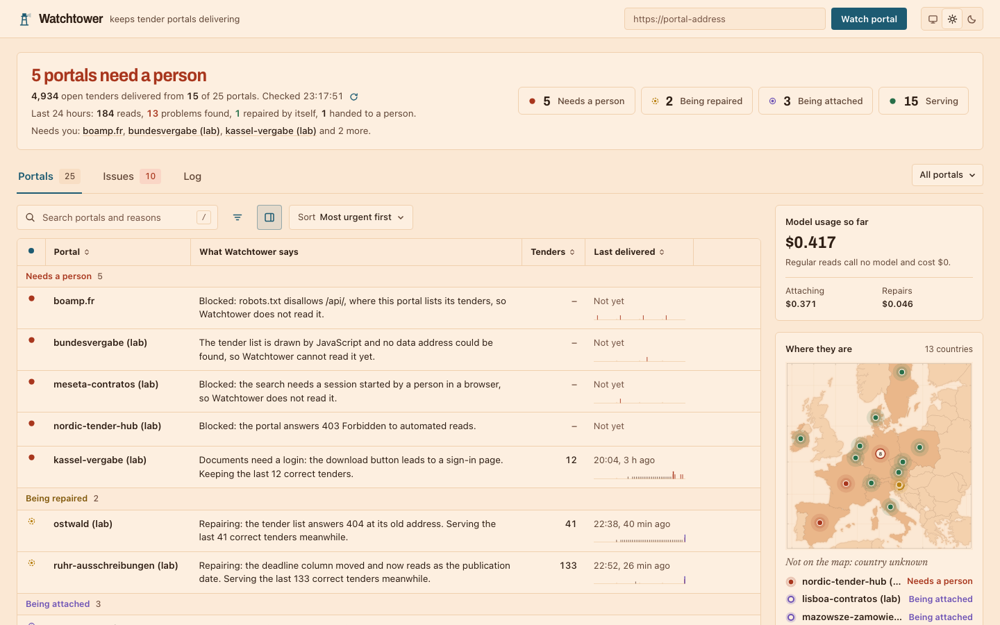
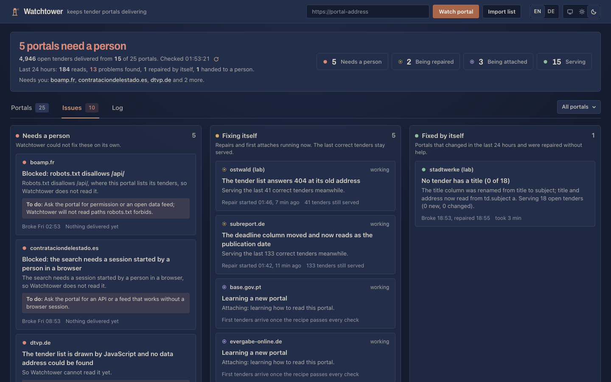

# Watchtower

Watchtower **attaches** to public tender portals from a URL, **notices** when tenders or documents stop arriving correctly, and **repairs** its extraction rules when a portal changes. It does this without human help while running. If it cannot verify a repair, it explains why and keeps the last correct delivery.

## Run it

Create a local `.env` from `.env.example` if needed. Set `OPENAI_API_KEY`; set `MODEL_SMART` and `MODEL_FAST` if your provider uses names other than the defaults below. Use the root Dockerfile, not `Dockerfile.vercel` (the hosted demo).

```bash
test -f .env || cp .env.example .env
docker build --platform linux/amd64 -t watchtower .
docker run -p 8080:8080 --env-file .env watchtower
```

Open [localhost:8080](http://localhost:8080) and enter a public portal URL under **Watch portal**. The API returns its ID immediately; delivery follows in the background. No authentication, as the brief specifies. To check the API from another terminal, run `npm run test:contract` after installing the dependencies with `npm ci`. The [November 21, 01:47 CET hand-in check](status/A.md) at `c74950d` records a fresh Linux/amd64 build in about **20 s** and **16/16** contract checks passing.

## How it works

```text
POST /portals → Cartographer (model at attach) → JSON recipe
    → Extractor (no model; per-host rate limit) → Watch checks → serving
        ↳ broken → healing (keeps old tenders) → Medic (model patch)
            → re-read + golden records + document verification → serving or failed with reason
```

- **Recipes** describe where to read listings, fields and attachments; they are JSON, not executable model output. Known software families can reuse a recipe after a successful trial without a model call.
- **Golden tenders** are previously verified records used to check new reads and candidate repairs. Missing evidence never becomes an invented value.
- **Files** stream to disk, ZIPs are unpacked, and each file is served by its SHA-256. Repair promotion checks fresh downloads of previously delivered files, even when their URLs did not change.
- **States** distinguish `integrating`, `serving`, `healing`, and `failed`. A portal-wide login, captcha or robots.txt block gets a named failure; isolated document walls hold affected updates back and are named in the reason.
- **Rate limits** apply to HTTP and browser requests through a shared per-host gate: at most one request per second, respecting robots.txt. Reads on different hosts run in parallel.
- **Many portals at once** run side by side with no queue. A model 429 (rate limit) waits for `Retry-After`, or backs off 2 s, 4 s, 8 s and so on, for up to 5 retries before the portal fails; an exhausted quota fails at once with the provider's reason. All portals share one Chromium: if it crashes, the next page launches a new one and every page that died with it is retried once.
- **Spend limits** reserve estimated headroom before each model request. A failed repair cools down before another model attempt; regular checks continue without a model call.

## Evidence by judging criterion

**Attach.** The November 21, 02:50–03:02 CET attach-only eval on all eight lab portals at `a3de073` scored **83% of fields correct (814 of 979) with 2 wrong values** on the seven attachable portals. Stadtwerke (**14/14**), Ville (**11/11**), Gmina (**13/13**) and Polder (**12/12**) scored **100%**. Gemeinde scored **90%** and Kommune **72%**; each served one cancelled tender as open. Comune delivered **5 of 13** tenders (**21%**). Obec failed as it should: its documents need a login. The earlier 00:59–01:04 CET recheck at `29ec17a` scored **100%, zero wrong values** on Gmina, Stadtwerke and Ville. The November 20, 22:28 CET full lab run scored **73%, zero wrong values**; missing fields reduced that score (D’s archived `status/D.md` at `931e012`).

**Notice.** Watch checks read completeness, field values and golden records before delivery. The latest Gmina change run (November 21, 00:02 CET, after the empty-day and Medic fixes) noticed **100%** of changes correctly, with **0 false repairs in 2** harmless changes (cookie banner, empty day) and a moved document link that left tenders unaffected. The earlier November 20, 22:28 CET full run, before those fixes, had **3 false repairs in 6**.

**Repair.** The 22:28 full run healed **11 of 13** breaking changes (**85%**), with a **16 s** median. The 00:02 Gmina run healed moved list, new pagination and date format (median **45 s**, **$0.063** per repair); renamed classes failed there and stayed honest, and after the Medic retry fix it repaired in **78.7 s** for **$0.014** (November 21, 00:29 CET). These are lab observations, not live-portal guarantees.

**Dashboard.** Portals shows state, open versus delivered counts, and the map; Issues shows what needs attention; Log and the detail panel show reads, repairs, and model cost. See the sample views below.

**Approach.** After the initial backlog clears, reads still check the listing but only fetch new or changed details and attachments. The TenderNed measurement recorded November 21 at 01:29 CET (`f9c4577`, [A’s hand-in notes](status/A.md)) listed **2,592** tenders and served its first **36** after about **14 minutes**; B’s November 21 handoff records a separate run at about **8.5 minutes** ([B’s notes](status/B.md)).

## Model cost per portal

| Operation | Model cost | Basis |
|---|---:|---|
| Attach once | $0.029 average | November 21, 02:50–03:02 CET attach-only eval on all eight lab portals ($0.009–$0.060); B’s November 20, 23:12 CET run on three portals averaged $0.033. |
| Regular read | $0 | Deterministic extractor; no model call. |
| Repair | $0.021 average | November 20, 22:28 CET full lab eval, per scenario that started a repair. |
| Family attach | $0 | A reused recipe that passes its trial without a model call. |

At the $0.029 lab average, **1,000 independent attaches would cost about $29 once**, plus repairs when portals change. This assumes no family reuse and excludes hosting and storage. The ledger uses configured prices and reported usage; provider billing is authoritative.

## Environment variables

Defaults below come from `src/platform/config.ts`, `src/platform/documents.ts`, `src/shared/time.ts`, `src/llm/client.ts`, `src/server/main.ts`, and the root Dockerfile.

| Variable | Required | Default / meaning |
|---|---|---|
| `OPENAI_API_KEY` | For model calls | None; provider key. |
| `MODEL_SMART`, `MODEL_FAST` | No | `gpt-6.2-sol`, `gpt-6-luna`; override with models your provider serves. |
| `OPENAI_BASE_URL` | No | OpenAI endpoint; set for an OpenAI-compatible provider. |
| `PRICE_SMART_IN`, `PRICE_SMART_OUT`, `PRICE_FAST_IN`, `PRICE_FAST_OUT` | No | `0`; set actual USD per million tokens for meaningful cost and spend limits. |
| `PRICE_SMART_CACHED_IN`, `PRICE_FAST_CACHED_IN` | No | Half the corresponding input price, USD per million tokens. |
| `LLM_PROMPT_CACHE` | No | Enabled; set `0` to disable. |
| `MAX_MODEL_USD_PER_PORTAL`, `MAX_MODEL_USD_PER_DAY` | No | `3.00` per portal (deleting a portal resets it) and `20` per local day; `0` disables the corresponding model calls. |
| `PORT`, `DATA_DIR` | No | `8080`; `/data` in Docker, `./data` locally. |
| `READ_INTERVAL_MINUTES`, `FAILED_RETRY_MINUTES` | No | `30` each; interval between scheduled reads and between failed-portal probes. |
| `DOC_REFS_PER_READ`, `FIRST_DOC_REFS` | No | `300` document references per read, `60` until a portal first serves, so its first tenders arrive within minutes. |
| `MIN_REQUEST_GAP_MS` | No | `1100`, minimum `1000`; per-host pacing. |
| `MAX_FILE_BYTES`, `BROWSER_STEP_MS` | No | `262144000` (250 MiB); `20000` ms for browser download steps. |
| `USER_AGENT` | No | `WatchtowerBot/0.1 (+tender monitoring; polite, 1 req/s)`. |
| `TZ_DISPLAY`, `LOG_LEVEL` | No | `Europe/Berlin`, `warn`. |
| `SEED_DEMO` | No | Off; `1` seeds an empty store and disables the scheduled reader. |

## Dashboard demo

Open [localhost:8083](http://localhost:8083) after running the commands below from the repository root. The demo uses sample data and does not start scheduled reads or model calls; leave **Read now** untouched to keep it that way.

```bash
npm ci
npm run build:web
DATA_DIR=/tmp/wt-readme-demo PORT=8083 npx tsx scripts/demo.ts
```

| Portals · light | Issues · dark | Portals · phone |
|---|---|---|
|  |  |  |

## Limits

Large portals can take several minutes to deliver their first verified batch. Browser-only portals are slower because their page requests share the same rate limit. Watchtower never logs in to a portal or solves a captcha.

## API

| Call | Answer |
|---|---|
| `POST /portals` `{ "url": ... }` | 201 with `{ "id": ... }`; the same address twice gives the same id |
| `GET /portals`, `GET /portals/{id}` | Portals with `state`, `reason`, `tenderCount`, `lastSuccessAt` |
| `POST /portals/{id}/refresh` | 202 with a `runId` (the running job's, if one runs) |
| `GET /portals/{id}/tenders[?changedSince=]` | Tenders with their documents |
| `GET /portals/{id}/runs` | Reads and repairs, with results |
| `DELETE /portals/{id}` | 204; all traffic to the portal stops |
| `GET /files/{sha256}` | A document's bytes |
| `GET /` | Dashboard |

Exact shapes: `src/shared/contract.ts`. Every time has an offset, e.g. `2026-12-09T10:00:00+01:00`. Check a running server with `npm run test:contract`.
